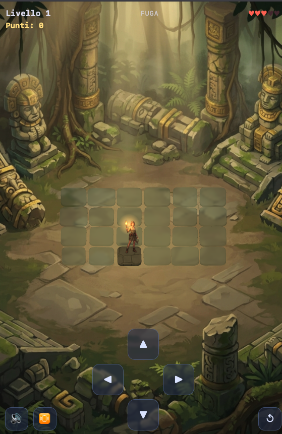

# Fuga dal Tempio

Gioco browser 3D isometrico di memoria e inseguimento. Durante una breve
anteprima il percorso corretto si illumina attraverso un tempio Inca
abbandonato nella giungla: il giocatore lo memorizza, poi lo ripercorre a
memoria mentre il guardiano di pietra lo insegue avanzando a velocità costante
lungo lo stesso tracciato. Scritto in JavaScript vanilla con Three.js, senza
framework né build step.

I tre pilastri sono **memoria visiva**, **inseguimento in tempo reale** e
**risk vs. reward**: deviare dal percorso per raccogliere un power-up fa
perdere passi preziosi, ma il guardiano non devia mai.

## Immagini

| In gioco (mobile) |
|---|
|  |

## Come si gioca

Comandi da tastiera:

- Frecce o WASD: muovere l'esploratrice
- R: ricominciare la partita
- V: attivare/disattivare la vibrazione dello schermo (screen shake)
- Invio: confermare il nome nella classifica a fine partita
- Pulsante 🔊 in basso a sinistra: attivare/disattivare l'audio

Su dispositivi mobili sono presenti un D-Pad touch e gli stessi pulsanti su
schermo. Il target primario è proprio lo schermo verticale del cellulare.

Ogni round si svolge in quattro fasi:

1. **Anteprima** — il percorso corretto si illumina (giada il tracciato, ambra
   le deviazioni, oro i power-up). L'input è disabilitato: va solo memorizzato.
2. **Fuga** — tutto si spegne tranne le caselle sbloccate. Il giocatore si
   muove a memoria; il guardiano è ancora fermo.
3. **Inseguimento** — scaduto il vantaggio iniziale il guardiano parte e avanza
   a velocità costante lungo il percorso corretto, un passo alla volta.
4. **Esito** — vittoria (traguardo raggiunto), cattura o game over.

Un passo su una casella sbagliata costa una vita e rimanda indietro di una
posizione. Se il guardiano raggiunge il giocatore si perde una vita e si
riparte dall'inizio; se arriva al traguardo per primo è game over immediato.
Raggiungere l'ultima riga supera il livello, e il successivo è più lungo e più
veloce.

Il punteggio è cumulativo: **+1** per ogni casella scoperta per la prima volta,
**−1** per ogni casella percorsa dal guardiano. A fine partita, se si entra tra
i primi dieci, si inserisce il nome e il punteggio viene salvato in classifica.

Lungo i rami ciechi che si diramano dal percorso principale ci sono i power-up:

- **Vita Extra** (cuore rosso) — una vita in più, fino al massimo
- **Gelo** (fiocco di neve) — il guardiano resta immobile per qualche secondo
- **Rivelatore** (maschera Inca dorata) — il percorso si illumina di nuovo
- **Ali d'Angelo** (raro) — superano subito il livello; la probabilità di
  comparsa cresce con il livello

## Come lanciarlo in locale

La classifica è gestita da `leaderboard.php`, quindi non basta aprire
`index.html` come file: serve un server che esegua il PHP. Il modo più semplice
è il server integrato di PHP. Dalla cartella del progetto:

    php -S localhost:8000

Poi aprire `http://localhost:8000` nel browser. Va bene anche qualsiasi altro
server con PHP (Apache, XAMPP, MAMP, ecc.) che serva la cartella del progetto
come document root. Il frontend usa percorsi relativi, quindi funziona anche in
una sottocartella.

Perché il salvataggio dei punteggi funzioni, la cartella `assets/` deve essere
scrivibile dal server web: lì viene creato a runtime il file
`assets/leaderboard.json` (non versionato). Per solo giocare senza classifica è
sufficiente un qualsiasi server statico.

## Com'è fatto

- Rendering: **Three.js** (vendorizzata in locale in `assets/vendor/` e
  risolta via `importmap`), `OrthographicCamera` per la vista isometrica
- Logica: JavaScript vanilla con ES module nativi, **nessun build step**,
  nessun bundler, nessuna dipendenza esterna oltre a Three.js
- Audio: sintetizzato a runtime con la Web Audio API, senza file audio
- Grafica: fondale e personaggi sono immagini dipinte (l'esploratrice e il
  guardiano come sprite billboard scontornati); le caselle sono tile di vetro
  smerigliato che, una volta percorse, diventano lastre di pietra Inca; le
  icone dei power-up sono disegnate via codice su canvas
- Classifica: backend PHP che salva i punteggi su file JSON, senza database
- Timing: accumulatore su `performance.now()` con delta time, mai `setTimeout`
  o `setInterval`, così la cadenza non si rompe quando la scheda va in background

Un vincolo di architettura: **`src/core/` non importa mai Three.js**. Tutta la
logica di gioco gira senza renderer, ed è giocabile da `debug.html` come griglia
di `
` colorati — utile per capire se un bug sta nel motore o nel rendering.

Struttura delle cartelle:

    index.html        entry point del gioco (Three.js)
    debug.html        vista di debug DOM del solo motore, senza 3D
    leaderboard.php   classifica a punti (GET top 10 / POST salva) su JSON
    manifest.json     web app manifest (installabile sulla home del cellulare)
    src/
      config.js       tutti i parametri di bilanciamento
      core/           logica pura: griglia, percorsi, villain, power-up, stato
      render/         Three.js: scena, camera, tile, attori, texture
      input/          tastiera e touch
      audio/          suoni procedurali
      main.js         collega core + render + input
    assets/           sprite, immagini, icone, Three.js vendorizzata

Tutti i numeri che riguardano il bilanciamento stanno in `src/config.js`:
durate delle fasi, velocità del guardiano, cooldown dei passi, vite, effetti
dei power-up e la curva di difficoltà per livello.

## Perché esiste — La storia dietro il gioco

È nato come un esperimento: provare a costruire un gioco 3D completo per browser
con JavaScript vanilla, senza framework e senza build step, sfruttando l'IA per
accelerare la prototipazione. Quella che sembrava una cosa da un paio di serate
si è rivelata un percorso molto più ricco. L'IA ha velocizzato la stesura
iniziale, ma la vera sfida è arrivata dopo: il bilanciamento tra la velocità del
giocatore e quella del guardiano — la manopola che decide se il gioco è teso o
frustrante — il testing continuo, e la direzione artistica del tempio Inca, dal
fondale dipinto alle tile di vetro che diventano pietra sotto i passi.

## Licenza

© 2026 Fabio Zappa. All Rights Reserved. Il codice è stato sviluppato con il
supporto di strumenti d'IA ed è attualmente distribuito a scopo dimostrativo.
